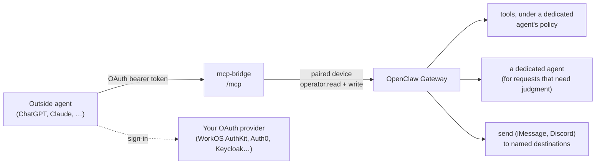

# mcp-bridge

An OAuth-protected MCP server that offers a **curated, config-defined** set of OpenClaw capabilities to outside agents:
a ChatGPT Dot, Claude, or anything else that speaks remote MCP with OAuth.

It is not a mirror of OpenClaw's tools. You declare a handful of intent-level tools ("house status", "calendar",
"change something", "send a message"), each tied to a risk tier, and the bridge does the rest: sign-in, condensing
results so they don't flood the client's context, and talking to OpenClaw as its own paired device.



## What you can reuse

| Part | What it gives you |
|---|---|
| **OAuth resource server** (`auth.ts`) | RFC 9728 protected resource metadata, the `401` + `WWW-Authenticate` challenge that starts ChatGPT's sign-in, JWT checks (signature via JWKS, `iss`, `aud` = your MCP URL, `exp`) and a `sub` allowlist. Works with any authorization server that issues JWT access tokens and honors resource indicators |
| **Paired Gateway device** (`gateway.ts`, `pair.ts`) | Pairs once with OpenClaw as its own operator device (no admin), stores an Ed25519 identity and device token, then calls `chat.send` / `agent.wait`, `tools.invoke` and `send`. Uses the official `@openclaw/gateway-client` |
| **Config-defined tools** (`config.ts`, `tools.ts`) | Tools as data: name, description, `read` or `change`, a few validated parameters, and one action: `invoke`, `ask` or `send` |
| **Condensers** (`condense.ts`) | `home-assistant-status` (~90 KB of raw state → ~1 KB) and `calendar-events` (sorted one-line events across calendars) |
| **Hardening** (`server.ts`, `index.ts`) | Stateless Streamable HTTP, fails closed without auth config, auth before the body is read, Host allowlist, POST only, 1 MiB body limit |

## Tool definitions

`MCP_BRIDGE_TOOLS` points at a JSON file. See [`tools.example.json`](tools.example.json).

```json
{
  "name": "home",
  "instructions": "What this server is for, and what it can't do.",
  "agent": "external",
  "timezone": "America/Los_Angeles",
  "ignoreEntities": ["light.status_led_*"],
  "tools": [
    { "name": "house_status", "kind": "read", "description": "…",
      "invoke": [{ "tool": "hass_state_list", "args": { "domain": "light" }, "label": "Lights" }],
      "condense": "home-assistant-status" },
    { "name": "calendar", "kind": "read", "dateRange": true, "description": "…",
      "invoke": [{ "tool": "ics_calendar_fetch", "args": { "calendar_id": "family" }, "label": "Family" }],
      "condense": "calendar-events" },
    { "name": "control_house", "kind": "change", "description": "…",
      "params": { "request": { "type": "string", "maxLength": 500 } },
      "ask": { "prompt": "…Request: {request}" } },
    { "name": "send_message", "kind": "change", "send": true, "description": "…" }
  ]
}
```

| Field | Meaning |
|---|---|
| `kind` | `read` tools are annotated read-only, so clients like ChatGPT run them without asking. `change` tools aren't, so clients ask the user first |
| `invoke` | Call these OpenClaw tools directly (`tools.invoke`) under `agent`'s tool policy. No model involved |
| `condense` | Built-in condenser for the `invoke` results; without one, the raw outputs are returned |
| `dateRange` | Adds `range` (`today`, `tomorrow`, `this_week`, `next_7_days`) or `start`/`end` dates, mapped onto every call's `after`/`before` |
| `ask` | Send `prompt` to an agent (`agent`, or the tool's own) and return its reply. `{param}` placeholders are filled with validated values; strings are JSON-quoted so they read as data |
| `send` | Send to a named destination from the private destinations file; no model involved |
| `params` | `enum`, `date` (YYYY-MM-DD) or `string` (with `maxLength`). A `read` tool that asks an agent can't take free text |

## Setup

1. **Build:** `npm ci && npm run build && npm test`.
2. **Agent:** create a dedicated OpenClaw agent for outside assistants with only the tools you want reachable, and point
   `agent` at it. `invoke` calls run under its tool policy, so plugin guards scoped to that agent still apply.
3. **Pair once** (the shared Gateway token is used for this command only, never stored):
   ```bash
   OPENCLAW_GATEWAY_TOKEN=… node dist/pair.js
   openclaw devices list   # mcp-bridge: role operator, scopes operator.read + operator.write
   ```
4. **Destinations** (optional), in `MCP_BRIDGE_DEVICE_DIR/destinations.json` (mode 600, never in a repo):
   `{ "owner": { "channel": "imessage", "to": "+1…" }, "family": { "channel": "discord", "to": "channel:<id>" } }`
5. **OAuth provider:** register the MCP URL as a resource (WorkOS calls it a resource indicator; set it as the default),
   enable client registration (Client ID Metadata Documents and/or Dynamic Client Registration), and restrict sign-up.
6. **Publish** the MCP URL over HTTPS on **port 443** (ChatGPT won't connect to other ports). With Tailscale Funnel,
   mount `/mcp`, `/.well-known/oauth-protected-resource` and `/.well-known/oauth-authorization-server` onto the bridge.
7. **Run** with an env file holding the settings below, then add the server in your client with OAuth. The first
   sign-in is refused with `403` and logs the user's `sub`; add it to `MCP_BRIDGE_ALLOWED_SUBJECTS`.

| Env | Required | Description |
|---|---|---|
| `MCP_BRIDGE_TOOLS` | yes | Tool definitions JSON |
| `MCP_BRIDGE_RESOURCE` | yes | Public MCP URL, e.g. `https://<host>/mcp`; must match the provider's resource indicator |
| `MCP_BRIDGE_ISSUER` | yes | OAuth issuer, exactly as in tokens' `iss` |
| `MCP_BRIDGE_JWKS_URL` | no | Signing keys; default is `jwks_uri` from the issuer's metadata |
| `MCP_BRIDGE_ALLOWED_SUBJECTS` | no | Comma-separated `sub` values allowed in; empty means nobody |
| `MCP_BRIDGE_DEVICE_DIR` | no | Device identity, token and destinations (default `~/.openclaw/secrets/mcp-bridge`) |
| `MCP_BRIDGE_GATEWAY_URL` | no | Default `ws://127.0.0.1:18789` |
| `MCP_BRIDGE_ALLOWED_HOSTS` | no | Host allowlist; default loopback plus the resource's host |
| `MCP_BRIDGE_PORT` | no | Default 18793 |

Keep hostnames, issuer subdomains and user IDs in the env file, not in a repo.

## Security model

- **The front door is the OAuth check.** Every `/mcp` request needs a valid token for this resource from an allowed
  user, checked before the request body is read.
- **Reads can't be talked into changes.** `read` tools only take enums and dates, never free text into an agent.
- **Changes are confirmed by the client and checked by OpenClaw.** `change` tools are annotated as such; what an agent
  may actually do is decided by its tool policy and any guard plugins.
- **Sending bypasses models.** Only named destinations exist; the handles live in a private file.
- **The bridge is trusted local software.** Its device has `operator.write`, which OpenClaw also uses for `chat.send` to
  any agent, `tools.invoke`, and `send`. The bridge's code keeps itself to the configured tools; if the bridge process
  itself were compromised, those would be reachable. OpenClaw has no per-device agent restriction today (named roles
  do this for verified user profiles, not devices), and the session-only scopes need a verified user profile. Treat
  the bridge like any other paired operator client.
- **Commands are defused.** Agent prompts starting with `/` or `!` are prefixed so they aren't read as OpenClaw
  commands (the flag that would suppress them needs admin scope).

## Logs

Requests are logged with path and user agent, refusals with the reason (a `403` includes the `sub`), sends with the
destination name only.
